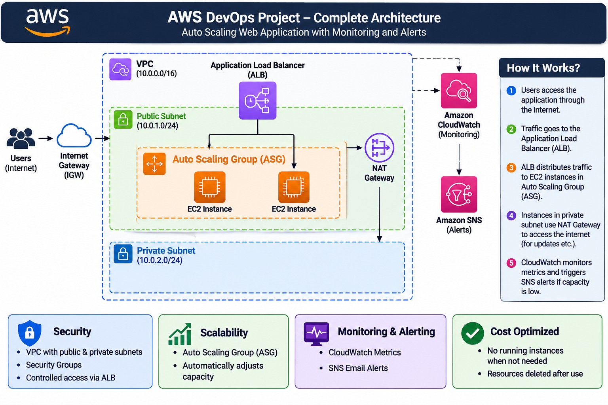

# Highly Available and Scalable Web Infrastructure on AWS

A hands-on AWS project demonstrating how to build, deploy, monitor, and automatically scale a web application using core AWS infrastructure services.

## Project Overview

The goal of this project was to build a highly available and scalable web infrastructure using AWS.

I created a custom VPC, configured public and private subnets across two Availability Zones, deployed an Application Load Balancer, and configured an EC2 Auto Scaling Group to automatically manage web server instances.

I also integrated Amazon CloudWatch and SNS to monitor infrastructure and receive email alerts.

## Architecture



```text
                         Internet
                            |
                            v
                  Internet Gateway (IGW)
                            |
                            v
                 Application Load Balancer
                       (Public Subnets)
                      /              \
                     /                \
              Availability Zone A   Availability Zone B
                     |                  |
                     v                  v
               Private Subnet A    Private Subnet B
                     |                  |
                     v                  v
                 EC2 Instance       EC2 Instance
                 (Nginx)             (Nginx)
                     \                  /
                      \                /
                       Auto Scaling Group
                                |
                                v
                       CloudWatch Monitoring
                                |
                                v
                           SNS Alerts
                                |
                                v
                         Email Notification

       Private Subnet outbound internet access:
              EC2 → NAT Gateway → IGW
```

## AWS Services Used

| Service | Purpose |
|---|---|
| Amazon VPC | Isolated network environment |
| Public and Private Subnets | Network segmentation across two AZs |
| Internet Gateway | Internet connectivity for public resources |
| NAT Gateway | Outbound internet access for private instances |
| Amazon EC2 | Hosts Nginx web servers |
| Security Groups | Controls inbound and outbound traffic |
| Application Load Balancer | Distributes incoming HTTP traffic |
| Launch Template | Defines EC2 instance configuration |
| Auto Scaling Group | Maintains and scales EC2 instances |
| AWS Systems Manager | Securely connects to private EC2 instances |
| Amazon CloudWatch | Monitors infrastructure metrics and alarms |
| Amazon SNS | Sends email notifications |

## Network Configuration

- **Region:** US East (N. Virginia) — `us-east-1`
- **VPC CIDR:** `10.0.0.0/16`
- **Availability Zones:** `us-east-1a` and `us-east-1b`

### Subnet Design

| Subnet | CIDR | Availability Zone |
|---|---|---|
| Public Subnet 1 | `10.0.1.0/24` | `us-east-1a` |
| Public Subnet 2 | `10.0.2.0/24` | `us-east-1b` |
| Private Subnet 1 | `10.0.11.0/24` | `us-east-1a` |
| Private Subnet 2 | `10.0.12.0/24` | `us-east-1b` |

The Application Load Balancer is deployed in the public subnets, while application EC2 instances run in private subnets.

## Auto Scaling Configuration

The Auto Scaling Group was configured with:

- Minimum capacity: 2 instances
- Desired capacity: 2 instances
- Maximum capacity: 3 instances
- Scaling policy: Target Tracking
- Average CPU utilization target: 50%
- Instance warmup: 180 seconds

### Scaling Test

I used `stress-ng` to generate CPU load on an EC2 instance through AWS Systems Manager Session Manager.

The test demonstrated:

1. The CPU utilization increased.
2. CloudWatch detected the increased CPU utilization.
3. The Auto Scaling policy triggered.
4. A third EC2 instance launched automatically.
5. The new instance registered with the target group and became healthy.
6. After stopping the CPU stress, the Auto Scaling Group scaled back down to two instances.

**Result:** Both scale-out and scale-in operations were successfully demonstrated.

## Monitoring and Alerts

Configured CloudWatch monitoring for the Auto Scaling Group.

Created a custom alarm:

- Alarm name: `devops-asg-low-capacity-alarm`
- Metric: `GroupInServiceInstances`
- Threshold: Fewer than 2 instances
- Evaluation period: 5 minutes
- Notification service: Amazon SNS

Tested the alarm by temporarily changing the threshold and successfully received an email notification.

## Security Configuration

- Application instances run in private subnets.
- HTTP traffic is allowed from the Application Load Balancer security group to the web server security group.
- The Application Load Balancer accepts public HTTP traffic.
- EC2 instances use an IAM role with `AmazonSSMManagedInstanceCore`.
- Systems Manager Session Manager was used instead of exposing SSH access to private instances.

## Technologies Learned

- AWS networking and VPC architecture
- Public and private subnet configuration
- Route tables and internet gateways
- NAT Gateway
- EC2 and Nginx
- Application Load Balancer
- Launch Templates
- Auto Scaling Groups
- CloudWatch metrics and alarms
- SNS email notifications
- IAM roles and policies
- AWS Systems Manager
- Infrastructure troubleshooting and monitoring

## Project Status

**Core AWS infrastructure implementation and scaling tests completed.**

Remaining improvements:

- CloudWatch dashboard
- Final security review
- Cost optimization and resource cleanup
- Architecture screenshots and documentation
- Infrastructure as Code using Terraform
- CI/CD integration

## Future Improvements

I plan to extend this project by introducing:

- AWS CLI automation
- Terraform for Infrastructure as Code
- Docker containerization
- Amazon ECR for container image storage
- GitHub Actions for CI/CD
- Prometheus and Grafana for monitoring

## What I Learned

This project helped me understand how different AWS services work together to build scalable and highly available infrastructure.

Rather than simply launching an EC2 instance, I gained practical experience with network design, private infrastructure, load balancing, automatic scaling, monitoring, alerting, and troubleshooting.

**Built as part of my DevOps and Cloud Engineering learning journey.**
